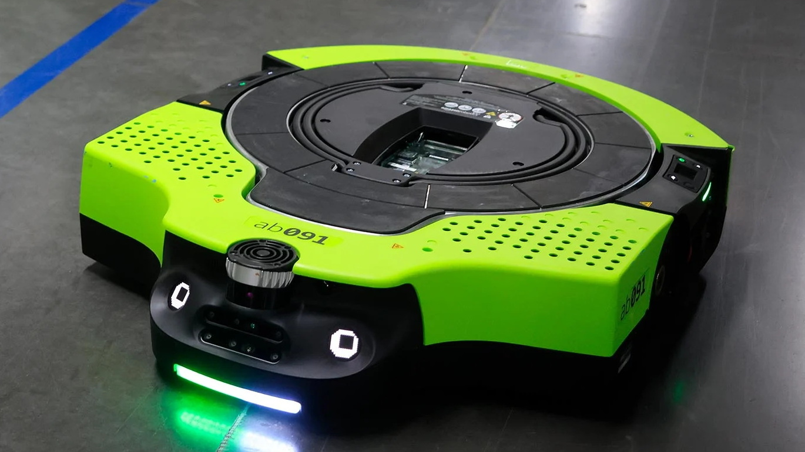

# Investigación sobre Configuraciones Mecánicas en Robots Móviles
------

## 1.- Conceptos Básicos

### Explicación con mis propias palabras

- **¿Qué es un robot móvil?**  
  Un robot móvil es una plataforma mecatrónica capaz de desplazarse e interactuar en su entorno mediante un sistema de locomoción (como ruedas, orugas o patas), sin estar fijada a un punto específico de trabajo.

- **Diferencia entre un robot móvil y un robot manipulador fijo:**  
  La diferencia principal es la **base de operación**. Un robot manipulador fijo (como un brazo industrial) tiene su base atornillada al piso o mesa y solo puede mover su herramienta final dentro de un espacio limitado. En cambio, un robot móvil transporta todo su cuerpo y puede navegar libremente por habitaciones, almacenes o terrenos abiertos.

- **Función del sistema de locomoción:**  
  El sistema de locomoción es el encargado de convertir la energía eléctrica o mecánica en movimiento para trasladar al robot de una coordenada a otra, superando obstáculos y manteniendo la estabilidad de la plataforma.

- **Movilidad omnidireccional:**  
  Significa que el robot puede desplazarse en cualquier dirección de un plano (adelante, atrás, izquierda, derecha o diagonales) e incluso rotar sobre su propio eje en el mismo instante, sin necesidad de realizar maniobras previas de giro.

- **Relación entre la disposición de las ruedas y los movimientos:**  
  La orientación y el tipo de ruedas determinan la *cinemática* del robot. Si las ruedas están fijas en paralelo, el robot solo puede avanzar en línea recta o dar curvas abiertas; si las ruedas están dispuestas en ángulos especiales (como a 90° o 45°), permiten sumar vectores de fuerza para lograr movimientos en cualquier dirección.

---

### Ámbitos de uso de los robots móviles

1. **Logística y almacenes:** Transportar tarimas o cajas dentro de centros de distribución (ej. almacenes de Amazon o Mercado Libre).

2. **Exploración espacial y científica:** Inspeccionar la superficie de otros planetas o terrenos peligrosos (ej. Rovers de la NASA en Marte).

3. **Limpieza y servicio doméstico:** Aspirado de alfombras en hogares (ej. aspiradoras iRobot Roomba) o desinfección en hospitales.

---

## 2.- Robot Diferencial con Rueda de Castor

### Descripción de la configuración.-

- **Ruedas motrices:** Cuenta con dos ruedas principales impulsadas por motores independientes colocadas en el mismo eje transversal (paralelas entre sí).

- **Rueda de castor (rueda loca):** Es una rueda pivote libre de tracción que gira en 360° para mantener el equilibrio de la estructura y evitar que se vuelque.

- **Avance en línea recta:** Ambas ruedas motrices giran a la misma velocidad y en el mismo sentido hacia adelante.

- **Giro hacia la izquierda o derecha:** Se reduce la velocidad de la rueda del lado hacia donde se desea girar respecto a la otra.

- **Diferencia de velocidad:** Si una rueda gira más rápido que la otra, el robot describe una trayectoria curva continua.

- **Giro sobre su propio eje:** Ocurre cuando una rueda gira hacia adelante y la otra hacia atrás exactamente a la misma velocidad; el centro de rotación queda ubicado justo en el punto medio entre ambas ruedas.

- **Ventajas:** Muy simple de construir, de bajo costo y fácil de controlar numéricamente.

- **Limitaciones:** No puede desplazarse lateralmente de forma directa (es un sistema no holonómico) y puede perder tracción en suelos irregulares.

- **Aplicaciones:** Robots aspiradora domésticos, robots educativos sencillos (como TurtleBot) y pequeños carros de reparto en interiores.

---

### Diagrama en Texto del Robot Diferencial

```text
               [ Sentido de Avance: ↑ ]

                   +---------------+
                   |               |
             [R. I.]|   Chasis del  |[R. D.]
             [====]|     Robot     |[====]
                   |               |
                   +-------+-------+
                           |
                        ( (O) )  <-- Rueda de Castor
                           |
               [ Eje de Giro: (*) Centro ]
```
### Tabla de Movimiento Diferencial

| Rueda Izquierda | Rueda Derecha | Movimiento del Robot |
| :---: | :---: | :---: |
| Avanza | Avanza | Avanza en línea recta |
| Detenida | Avanza | Giro cerrado a la izquierda sobre la rueda izquierda |
| Avanza | Detenida | Giro cerrado a la derecha sobre la rueda derecha |
| Avanza | Retrocede | Giro sobre su propio eje en sentido de las manecillas del reloj |
| Retrocede | Avanza | Giro sobre su propio eje en sentido contrario a las manecillas |
| Retrocede | Retrocede | Retrocede en línea recta |

---

## 3.- Robots Omnidireccionales con Ruedas Omni

### Funcionamiento de la Rueda Omni.-

- **Construcción:** Consiste en un rin principal metálico o plástico rodeado de pequeños rodillos libres situados en todo su perímetro.

- **Rodillos perimetrales:** Tienen sus ejes orientados a **90°** respecto al eje central de la rueda.

- **Generación de fuerza:** La rueda genera fuerza de tracción únicamente en la dirección de rotación del motor (hacia adelante/atrás).

- **Deslizamiento libre:** Permite que la rueda se deslice sin fricción hacia los lados gracias al giro pasivo de los pequeños rodillos.

- **Nuevos movimientos:** Permite combinar fuerzas de varias ruedas para empujar el robot de lado sin cambiar la dirección hacia donde apunta el chasis.

---

### Configuración de 3 Ruedas (a 120°)

- **Distribución:** Las tres ruedas están separadas a 120° alrededor de una estructura circular o triangular.

- **Desplazamiento:**  

  - *Adelante/Atrás:* La rueda trasera permanece detenida y las dos delanteras giran en sentidos opuestos. 

  - *Lateral:* La rueda trasera gira a máxima velocidad mientras las delanteras giran suavemente para compensar la trayectoria.  

  - *Diagonal:* Se combinan las velocidades de dos ruedas simultáneamente. 

  - *Giro sobre su eje:* Las tres ruedas giran en el mismo sentido horario o antihorario a la misma velocidad. 

  - *Diferentes velocidades:* Permite realizar trayectorias complejas combinando traslación y rotación al mismo tiempo.

#### Dibujo Visto desde Arriba (3 Ruedas Omni)

```text
                        [ Rueda 1 ]
                          /-----\
                         | [===] |
                          \-----/
                         /       \
                        / Chasis  \
                       /           \
               /-----\               /-----\
              | [===] |             | [===] |
               \-----/               \-----/
             [ Rueda 2 ]           [ Rueda 3 ]
```

### Configuración de 4 Ruedas OmniUbicación

- **Ubicación:** Colocadas a 90° una de otra formando una "X" o una cruz respecto al chasis.

- **Combinación de velocidades:** Activando los pares opuestos se logra avance longitudinal o lateral puro; activando todas se logra rotación pura.

- **Diferencia con 3 ruedas:** Distribuye mejor el peso de la plataforma, tiene mayor estabilidad mecánica y las ecuaciones de control son más sencillas al usar un plano cartesiano directo ($X, Y$).

- **Ventajas:** Excelente maniobrabilidad en espacios cerrados.Limitaciones: Reducción de la fuerza de arrastre y baja tracción en pisos resbalosos.

## 4.- Robot Omnidireccional con Ruedas Mecanum

### Características de la Rueda Mecanum.-

- **Construcción:** Es una rueda especial provista de rodillos ubicados alrededor de su circunferencia montados a un ángulo oblicuo de 45°.

- **Diferencia con rueda Omni:** En la rueda Omni el rodillo está a 90°, mientras que en la rueda Mecanum al estar a 45° genera una fuerza en diagonal que se descompone en componentes longitudinales y laterales.

- **Uso de 4 ruedas:** Se requieren exactamente 4 ruedas (dos tipo "Derecha" y dos tipo "Izquierda") montadas de forma que la orientación de los rodillos forme un patrón en "X" cuando el robot se ve desde arriba.

#### Dibujo Visto desde Arriba (Orientación de Rodillos en "X")

                [ Frontal Robot ]
               +-----------------+
               | /////     \\\\\ | <-- Ruedas Delanteras (Rodillos a 45°)
               |                 |
               |     Chasis      |
               |                 |
               | \\\\\     ///// | <-- Ruedas Traseras (Forman patrón "X")
               +-----------------+

### Tabla de Sentido de Giro para Ruedas Mecanum

| Movimiento | Delantera Izquierda | Delantera Derecha | Trasera Izquierda | Trasera Derecha |
| :---: | :---: | :---: | :---: | :---: |
| **Avanzar** | ↑ | ↑ | ↑ | ↑ |
| **Retroceder** | ↓ | ↓ | ↓ | ↓ |
| **Desplazarse a la Izquierda** | ↓ | ↑ | ↑ | ↓ |
| **Desplazarse a la Derecha** | ↑ | ↓ | ↓ | ↑ |
| **Girar a la Izquierda** | ↓ | ↑ | ↓ | ↑ |
| **Girar a la Derecha** | ↑ | ↓ | ↑ | ↓ |

## 5.- Robot con Dirección Ackermann

### Geometría de Dirección Ackermann.-

- **Distribución de ruedas:**Tiene dos ruedas traseras sobre un eje fijo y dos ruedas delanteras orientables conectadas mediante un varillaje mecánico de dirección.

- **Ruedas de dirección / tracción:** La dirección la dan las ruedas delanteras. La tracción suele estar en las ruedas traseras (como en un automóvil convencional).

- **Ángulo de giro diferencial:** En una curva, la rueda interior gira a un ángulo mayor que la rueda exterior. Esto se hace para que todas las ruedas roten sobre círculos concéntricos alrededor de un mismo punto de giro y no patinen.

- **Radio de giro:** Es la trayectoria mínima sobre la cual el vehículo puede dar una vuelta completa.

- **Movimiento lateral:** No puede desplazarse de lado porque sus ruedas están restringidas mecánicamente para avanzar solo hacia adelante o atrás.

- **Semejanza con autos:** Utiliza el mismo sistema técnico usado en vehículos de pasajeros, camionetas y camiones.

#### Dibujo de Giro en Curva (Ackermann)

                           [ Dirección ]
                             \   
            (R. Exterior) [=] \               
                                \              / [=] (R. Interior - Ángulo mayor)
                            +----+------------+----+
                            |                      |
                            |   Vehículo Ackermann |
                            |                      |
                            +----+------------+----+
                                [=]          [=]
                                 \            /
                                  \          /
                                   \        /
                                    * Centro de Giro (ICR)

- **Ejemplos reales:** Autos autónomos de prueba (Waymo, Tesla Robotaxi), carritos de golf robotizados y rovers agrícolas.

## 6.- Comparación de Configuraciones

### Tabla Comparativa

| Configuración | N° Típico de Ruedas | Movimiento Lateral | Giro sobre su Eje | Complejidad Mecánica | Complejidad de Control | Aplicaciones |
| :---: | :---: | :---: | :---: | :---: | :---: | :---: |
| **Diferencial + Castor** | 2 motrices + 1 castor | No | Sí | Baja | Baja | Aspiradoras, robots educativos. |
| **Omni de 3 ruedas** | 3 omni | Sí | Sí | Media | Media | Robots de competencia RoboCup. |
| **Omni de 4 ruedas** | 4 omni | Sí | Sí | Media | Media | Plataformas de inspección. |
| **Mecanum** | 4 mecanum | Sí | Sí | Alta | Alta | Montacargas de fábrica, plataformas KUKA. |
| **Ackermann** | 4 convencionales | No | No | Alta | Media | Vehículos autónomos y autos. |

---

### Elección de Configuración por Caso Práctico

1. **Robot pequeño para aprender programación:** **Diferencial + Castor.** Es la más fácil de controlar numéricamente y requiere menos componentes electrónicos.

2. **Robot para almacén con espacios reducidos:** **Mecanum.** Permite maniobrar y acomodar cargas en pasillos estrechos entrando de lado.

3. **Plataforma que se mueve lateralmente sin cambiar orientación:** **Omni de 4 ruedas.** Mantiene el frente constante mientras recorre superficies cartesianas.

4. **Vehículo autónomo tipo automóvil:** **Ackermann.** Mantiene la física y estabilidad requerida para circular en calles urbanas a mayor velocidad.

5. **Robot de competencia para cambios rápidos de dirección:** **Omni de 3 ruedas.** Ofrece respuestas cinemáticas muy ágiles para esquivar rivales instantáneamente.

6. **Robot móvil sencillo con solo dos motores:** **Diferencial + Castor.** Con solo dos salidas de motor se logra control total de avance y giro.

---

## 7.- Análisis del Movimiento

### Explicación Física y Mecánica

- **Diferencial (Giro sobre eje):** 
Para girar en su sitio, una rueda debe aplicar fuerza hacia adelante y la otra hacia atrás con la misma magnitud. Esto genera un par de fuerzas cuyo centro de rotación coincide exactamente con el punto medio del eje, haciendo que el robot gire sin desplazarse del punto.

- **Omni (Movimiento lateral):** 
Los rodillos perimetrales están libres sobre ejes perpendiculares. Al aplicar fuerza en una dirección, la componente de resistencia lateral libera el giro pasivo de los rodillos, permitiendo que la rueda ruede hacia los lados sin que el motor arrastre goma sobre el suelo.

- **Mecanum (Movimiento lateral sin ruedas de costado):** 
Debido a que los rodillos están a 45°, cada rueda genera una fuerza diagonal compuesta por vectores $F_x$ y $F_y$. Al girar las ruedas del lado izquierdo y derecho en sentidos opuestos, los vectores longitudinales ($F_x$) se cancelan entre sí, mientras que los vectores laterales ($F_y$) se suman, empujando la estructura hacia un costado.

- **Ackermann (Incapacidad de movimiento lateral directo):** 
Es una restricción no holonómica. Las ruedas no pueden deslizarse de lado porque tienen alta fricción lateral y carecen de rodillos. Para cambiar de carril necesita un recorrido vectorial curvo aplicando avance o retroceso.

---

## 8.- Aplicación en un Robot Real

### Robot Seleccionado: Amazon Proteus

- **Fabricante:** Amazon Robotics.

- **Tipo de locomoción:** Omnidireccional / Mecanismo Diferencial Pesado.

- **Número y tipo de ruedas:** 2 ruedas motrices principales de alta tracción y 4 ruedas locas de soporte.

- **Sensores principales:** LiDaR 3D, cámaras de visión computacional, sensores de presión y ultrasónicos de seguridad.

- **Actuadores:** Motores eléctricos brushless DC de alto torque y cilindro elevador hidráulico/eléctrico.

- **Aplicación:** Transporte autónomo de carros de carga (GoCarts) con paquetes dentro de los centros de logística de Amazon.

---

### Representación del Amazon Proteus



- **Justificación de la configuración:** 
La configuración diferencial pesada permite a Proteus girar sobre su propio eje directamente debajo de los carros de carga para levantarlos y transportarlos sin requerir espacio amplio para maniobrar dentro del almacén.

---

## Reflexión Final

De todas las opciones analizadas, la configuración diferencial con rueda de castor me pareció la más sencilla de comprender porque su principio físico equivale al funcionamiento básico de un tanque o una silla de ruedas manual.

Por otro lado, la configuración con ruedas Mecanum es la que ofrece mayor libertad de movimiento, ya que permite realizar traslaciones laterales directas sin necesidad de alterar la orientación frontal del vehículo.

Si tuviera que construir mi primer robot móvil, utilizaría definitivamente la configuración diferencial con rueda de castor; ya que tiene una simplicidad en el armado mecánico y la disponibilidad de controladores económicos facilitan concentrarse en el aprendizaje de la programación sin enredarse con matrices de transformación cinemática complejas.

Finalmente, no existe una sola configuración adecuada para todos los robots porque cada aplicación demanda prioridades distintas. Mientras que un vehículo industrial en un almacén requiere capacidad omnidireccional para maniobrar en pasillos estrechos, un vehículo autónomo de carretera necesita la estabilidad a alta velocidad y el bajo desgaste de llantas que únicamente la geometría Ackermann puede ofrecer.

---

## Referencias

1. Siegwart, R., Nourbakhsh, I. R., & Scaramuzza, D. (2011). *Introduction to Autonomous Mobile Robots* (2da ed.). MIT Press.
2. Corke, P. (2017). *Robotics, Vision and Control: Fundamental Algorithms in MATLAB* (2da ed.). Springer.
3. KUKA Roboter GmbH. (2021). *KMR iiwa: Mobile, autonomous, flexible*. KUKA Documentation. https://www.festa.com
4. Lynch, K. M., & Park, F. C. (2017). *Modern Robotics: Mechanics, Planning, and Control*. Cambridge University Press.
5. Amazon Robotics. (2022). *Meet Proteus: Amazon's first fully autonomous mobile robot*. Amazon Science. https://www.amazon.science